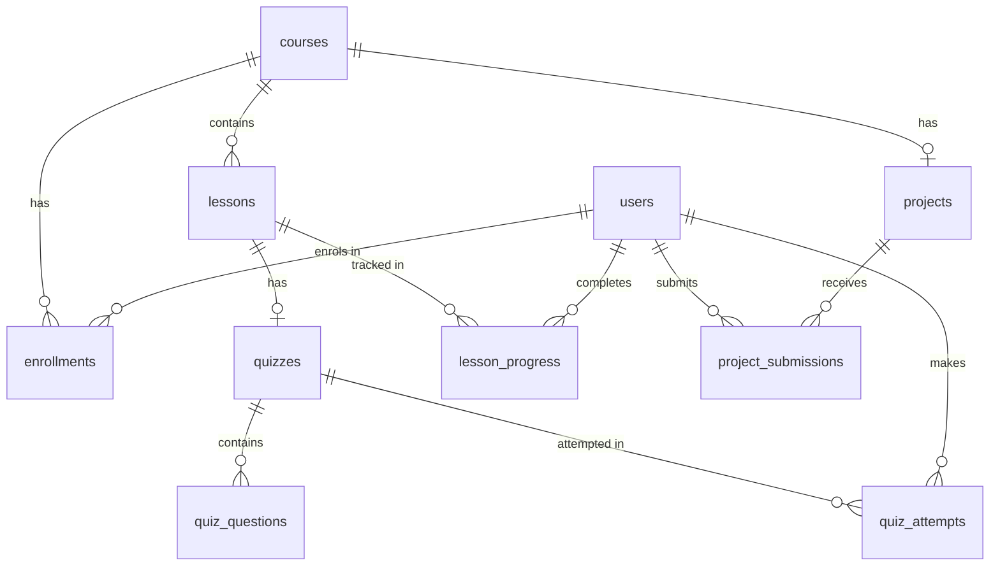

# MY-SQL-PROJECT
Using SQL 
# LearnSphereDB

A MySQL 8 relational database for **LearnSphere**, a free online learning platform. It stores users, courses, lessons, quizzes, enrolments, learner progress and project submissions, and demonstrates core database concepts: normalised tables, primary and foreign keys, constraints, a view, a trigger and a stored procedure.

> **Author:** OYEKAN ADETOMILOLA OLUWAFEYIKEMI
> **Database:** MySQL 8 | **Engine:** InnoDB | **Charset:** utf8mb4

---

## Table of Contents

1. [Project Overview](#project-overview)
2. [Features](#features)
3. [Database Structure](#database-structure)
4. [Entity Relationship Diagram](#entity-relationship-diagram)
5. [Getting Started](#getting-started)
6. [Sample Data](#sample-data)
7. [Testing the View, Trigger and Stored Procedure](#testing-the-view-trigger-and-stored-procedure)
8. [Useful Queries](#useful-queries)
9. [Project Structure](#project-structure)
10. [Future Improvements](#future-improvements)
11. [Author](#author)

---

## Project Overview

LearnSphere lets learners enrol in free courses, watch lessons, take quizzes and submit projects. **LearnSphereDB** is the database behind it. It was designed to:

- Keep each piece of data in one place (no duplication).
- Protect data integrity with keys, `UNIQUE` rules, `ENUM` types and `CHECK` constraints.
- Automatically clean up related records using `ON DELETE CASCADE`.
- Automate common tasks with a **trigger** and a **stored procedure**.
- Report learner progress through a **view**.


---

## Features

| Feature | Description |
|---|---|
| 11 tables | Users, courses, lessons, quizzes, questions, enrolments, progress, attempts, projects, submissions and an audit log |
| Constraints | Primary keys, foreign keys, `UNIQUE`, `NOT NULL`, `DEFAULT`, `ENUM` and `CHECK` |
| Cascading deletes | Deleting a course removes its lessons, quizzes, projects and related records |
| View | `v_course_progress` shows the percentage of each course a learner has completed |
| Trigger | `trg_enrollment_after_insert` writes every new enrolment to `enrollment_log` |
| Stored procedure | `sp_complete_lesson` marks a lesson complete only if the learner is enrolled |

---

## Database Structure

| # | Table | Purpose |
|---|---|---|
| 1 | `users` | Learners and admins (unique email, hashed password, role) |
| 2 | `courses` | Course catalogue (level: beginner, intermediate or advanced; free or not) |
| 3 | `lessons` | Ordered lessons that belong to a course (video URL and notes) |
| 4 | `quizzes` | One quiz per lesson |
| 5 | `quiz_questions` | Multiple-choice questions (options A to D and the correct answer) |
| 6 | `enrollments` | Which user is enrolled in which course (one enrolment per user per course) |
| 7 | `lesson_progress` | Lessons a learner has completed (composite primary key) |
| 8 | `quiz_attempts` | Score and total for each quiz attempt (`score <= total` is enforced) |
| 9 | `projects` | One project brief per course |
| 10 | `project_submissions` | A learner's submitted project link (one per project per user) |
| 11 | `enrollment_log` | Audit trail filled automatically by the trigger |

**Other database objects**

| Type | Name |
|---|---|
| View | `v_course_progress` |
| Trigger | `trg_enrollment_after_insert` |
| Stored procedure | `sp_complete_lesson(p_user_id, p_lesson_id)` |

---

## Entity Relationship Diagram



### ERD screenshot (from MySQL Workbench)


---

## Getting Started

### Prerequisites

- [MySQL Server 8.0+](https://dev.mysql.com/downloads/mysql/)
- [MySQL Workbench](https://dev.mysql.com/downloads/workbench/) (or the MySQL command line)

### Option 1: MySQL Workbench

1. Open MySQL Workbench and connect to your local server.
2. Go to **File > Open SQL Script** and choose `schema.sql`.
3. Click the lightning bolt icon (**Execute**) to run the whole script.
4. Refresh the **Schemas** panel on the left. You should see `learnsphere_db`.


## Sample Data

Run these statements to add a few rows so you can test everything.

```sql
USE learnsphere_db;

-- Users
INSERT INTO users (full_name, email, password_hash, role) VALUES
('Ada Okafor',  'ada@example.com',  'hashed_password_1', 'learner'),
('Tunde Bello', 'tunde@example.com', 'hashed_password_2', 'learner'),
('Admin User',  'admin@example.com', 'hashed_password_3', 'admin');

-- Courses
INSERT INTO courses (title, description, level, is_free) VALUES
('Introduction to HTML', 'Learn the basics of web pages.', 'beginner', 1),
('JavaScript Essentials', 'Learn programming for the web.', 'intermediate', 1);

-- Lessons
INSERT INTO lessons (course_id, lesson_no, title, video_url, notes) VALUES
(1, 1, 'What is HTML?',     'https://example.com/video1', 'Intro notes'),
(1, 2, 'HTML Tags',         'https://example.com/video2', 'Tags notes'),
(1, 3, 'Forms and Inputs',  'https://example.com/video3', 'Forms notes'),
(2, 1, 'Variables',         'https://example.com/video4', 'Variables notes');

-- Quiz and questions
INSERT INTO quizzes (lesson_id, title) VALUES (1, 'HTML Basics Quiz');

INSERT INTO quiz_questions
(quiz_id, question_text, option_a, option_b, option_c, option_d, correct_option) VALUES
(1, 'What does HTML stand for?',
    'HyperText Markup Language', 'High Tech Modern Language',
    'Home Tool Markup Language', 'Hyperlinks and Text Mark Language', 'A');

-- Project
INSERT INTO projects (course_id, title, brief) VALUES
(1, 'Personal Portfolio Page', 'Build a one-page portfolio using HTML.');
```


```sql
SELECT * FROM users;
SELECT * FROM courses;
SELECT * FROM lessons;
```


---

## Testing the View, Trigger and Stored Procedure

### 1. Trigger: `trg_enrollment_after_insert`

Enrolling a learner should automatically add a row to `enrollment_log`.

```sql
INSERT INTO enrollments (user_id, course_id) VALUES (1, 1);
INSERT INTO enrollments (user_id, course_id) VALUES (2, 1);

SELECT * FROM enrollment_log;
```


### 2. Stored procedure: `sp_complete_lesson`

```sql
-- Valid: user 1 is enrolled in course 1, so lesson 1 is marked complete
CALL sp_complete_lesson(1, 1);
CALL sp_complete_lesson(1, 2);

SELECT * FROM lesson_progress;
```


Test the error handling. User 1 is not enrolled in course 2, so this should fail:

```sql
CALL sp_complete_lesson(1, 4);
-- Error 1644: User is not enrolled in this course
```


### 3. View: `v_course_progress`

```sql
SELECT * FROM v_course_progress;
```


---

## Useful Queries

**Courses with the number of enrolled learners**

```sql
SELECT c.title, COUNT(e.user_id) AS total_learners
FROM courses c
LEFT JOIN enrollments e ON e.course_id = c.course_id
GROUP BY c.course_id, c.title
ORDER BY total_learners DESC;
```


**Lessons in a course, in order**

```sql
SELECT lesson_no, title
FROM lessons
WHERE course_id = 1
ORDER BY lesson_no;
```


**Average quiz score per quiz**

```sql
SELECT q.title,
       ROUND(AVG(100 * a.score / a.total), 1) AS avg_percent
FROM quiz_attempts a
JOIN quizzes q ON q.quiz_id = a.quiz_id
GROUP BY q.quiz_id, q.title;
```


**Constraint test: a duplicate enrolment is rejected**

```sql
INSERT INTO enrollments (user_id, course_id) VALUES (1, 1);
-- Error 1062: Duplicate entry for key 'uq_enrollment'
```


---

## Project Structure

```
LearnSphereDB/
├── schema.sql        # Database, tables, view, trigger and stored procedure
├── README.md         # Project documentation
└── screenshots/      # Images used in this README
    ├── 00-overview.png
    ├── 01-erd.png
    └── ...
```

---

## Future Improvements

- Add a `certificates` table for completed courses.
- Add course categories and tags.
- Add indexes on frequently searched columns to improve performance.
- Add a trigger that logs un-enrolments.
- Connect the database to the LearnSphere Node/Express application.

---

## Author

**OYEKAN ADETOMILOLA OLUWAFEYIKEMI**
Computer Science, Lagos State University (LASU)

- Email: adetomilolaoyekan7@gmail.com

---

*Built as a database project for the LearnSphere learning platform.*
